<div align="center">

# तगादा · Tagada

**Tagada, bina jhagda.** Chase what you're owed, without the quarrel.

A collections desk for India's small manufacturers: it ranks who to chase, calls them politely in Hindi, takes their payment on a pay link, matches the bank statement, and tells the owner whether salary day is safe.

**[Open the live app](https://app-web-dlk4.onrender.com)** · **[See every rupee checked](https://app-web-dlk4.onrender.com/proof)** · No login, no setup

[](https://github.com/Anikesh-Paul/hackcache-public/actions/workflows/ci.yml)


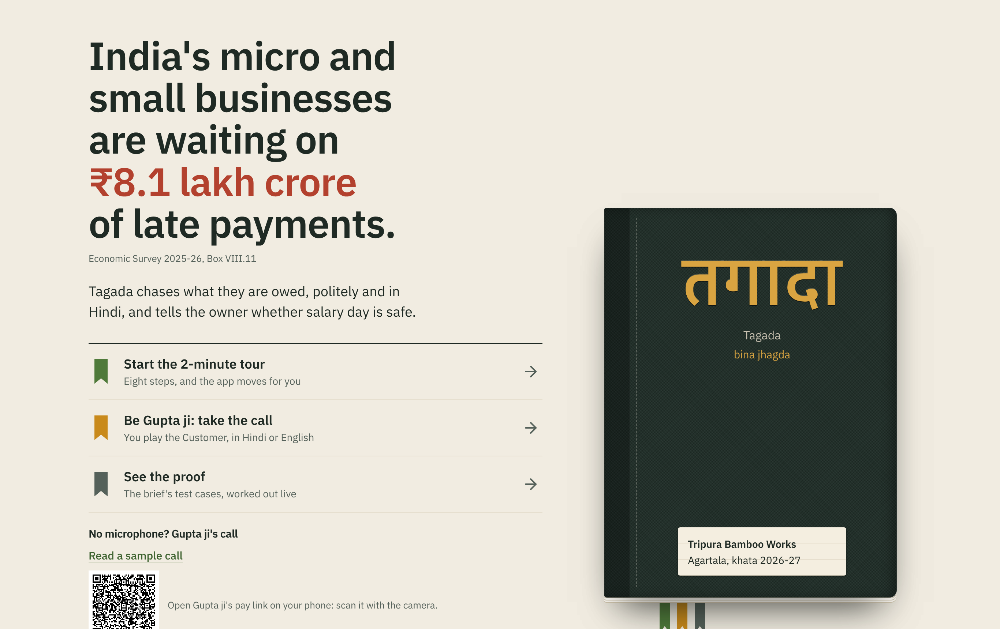

</div>

---

## The problem

India's micro and small businesses are waiting on **₹8.1 lakh crore** of late payments ([Economic Survey 2025-26](https://www.indiabudget.gov.in/economicsurvey/), Box VIII.11).

Meet Tripura Bamboo Works in Agartala: eight artisans and one accountant. On paper they're profitable. In practice, their customers in Kolkata and Guwahati pay weeks late, and every month the owner faces the same question: *can I pay salaries on the 10th?*

Today that owner chases each bill by hand. They remember who is overdue, phone in Hindi, write reminders, and check the bank statement line by line against "I've already paid." Nothing tells them what a customer's promise does to next week's cash.

Tagada opens on the one number that matters:

> **Salary day in 8 days · ₹48,000 short**

Every screen exists to turn that number green.

## Try it in 60 seconds

Open **[app-web-dlk4.onrender.com](https://app-web-dlk4.onrender.com)**. While you read the landing page, Tagada quietly builds **your own private copy of the books**: 12 customers and 31 invoices over six months. Nothing you do changes anyone else's screens. Then pick a way in: the tour is the big button, the call sits under it, and the other two are quieter links.

| Way in | What happens |
|---|---|
| **Start the 2-minute tour** | Eight steps. The app moves itself to each screen and changes the books for you, from ₹48,000 short to salaries covered, and ends on what Tagada changed: days to get paid 86 → 74. |
| **Be Gupta ji: take the call** | What makes Tagada different. You play the customer: speak Hindi or English to Munim, the AI agent, and watch the owner's books change as you talk. **No microphone?** opens the recorded call and a QR code for the pay link, right under the button. |
| **Make your own invoice** | A three-step guide. Bill any customer, or add one with your own name (GSTIN optional), pick a unit (kg, m, pcs…) and a part quantity like 2.5 kg, and choose the due date. Open its pay link as that customer, say it's paid, ask for time or dispute it, and watch Today and the bell change. Add or edit a Customer, record a payment by hand (cash, cheque, UPI or bank transfer), or edit or cancel an unpaid invoice. |
| **See the proof** | 45 test cases: the brief's (GST, interest, matching, the Ladder, grades) and Section 43B(h), computed live in your browser from the same code the app runs. |

**What's real?** under the doors says what is live and what is simulated. **Reset demo** in the header brings the starting story back at any time.

## What it does

### Today: is salary day safe?

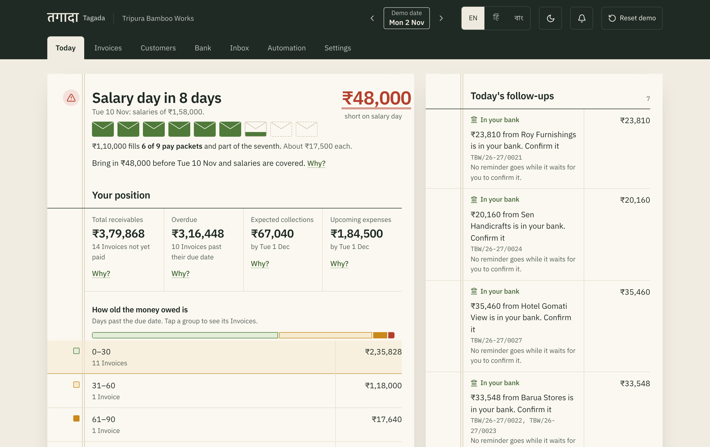

- **The headline**: salary day, the shortfall or the spare, and nine pay packets, one for each person paid that day, filling as cash is secured.
- **Why?** next to every number: opening cash plus expected receipts, minus salaries, rent and suppliers, to the day.
- **What Tagada changed**, once the tour is done: days to get paid (DSO) before and since Tagada started chasing, money brought forward this month, hours of chasing saved, and the cost per ₹100 collected, each worked from the events with a Why?.
- **Your position**: total receivables, overdue, expected collections (delay-adjusted) and upcoming expenses.
- **Ageing** in 0–30 / 31–60 / 61–90 / 90+ day buckets; tap one to open those invoices.
- **A 13-week cash forecast** drawn as ledger bars, with shortfall weeks hanging below the line and a table view for exact numbers.
- **Chase these first**: unpaid invoices ranked by how much of the gap each would close, how reliably that customer pays, and how much effort the chase takes, each with its reason in words.
- **Today's follow-ups**: what the Ladder wants sent today, with the message ready to go by WhatsApp or email.

### Call with AI: a polite Hindi call, with code holding the line

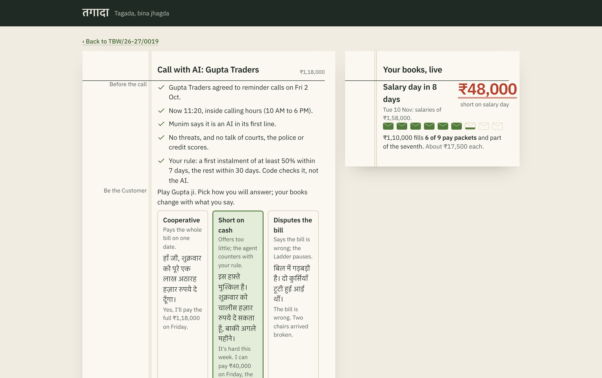

Munim is a Hindi voice agent that calls the customer from the browser: an ElevenLabs voice, with its replies written by **Claude Haiku 5.5**. Call with AI is on every open, undisputed invoice: after the due date it's a reminder call, before it a courtesy call. The guardrails are checked before every call, and you can see them:

- the customer's recorded consent, and calling hours (10 AM–6 PM on the demo clock);
- Munim says it is an AI in its first line;
- no threats, and no talk of courts, police or credit scores;
- **the owner's Plan rule** (by default: at least 50% within 7 days, the rest within 30).

**Code checks the Plan rule, not the AI.** When Gupta ji offers ₹40,000, the rule check appears in the margin and Munim counters with exactly the minimum, ₹59,000. When he says ₹60,000, the new figure is checked again. A plan outside the rule, or one missing a date, is refused by the server with a sentence telling the agent what to do instead. The owner sees *Plan agreed* or *Needs your decision* and can approve, counter or decline. Approving pauses the Ladder for that customer, puts the plan on the pay link, and turns the headline to **Salary covered, ₹12,000 spare**.

There are three personas to play (*Cooperative*, *Short on cash*, *Disputes the bill*), each with lines to say in Hindi and English, and every line Munim says comes with an English gloss. The cost of every call is computed from its real duration.

- **Every past call stays readable.** The invoice's timeline has *Show transcript* on each call: who said what and when, with the same English gloss. A fresh workspace already has one, Gupta ji's earlier call.
- **Never a dead button.** Each workspace gets 5 calls and the whole app 60 a day, so the public link can't drain the voice credits. When calls are off, used up or outside calling hours, the call screen says why and plays the recorded call instead; outside hours, **Set the clock to 11 AM** brings the demo clock back inside them.
- **The agent lives in the repo.** Its prompt, first line, voice, model and client tools are in [`apps/server/src/agent/`](apps/server/src/agent/), and `pnpm agent:sync` rebuilds it on ElevenLabs.

### The pay link: what the customer sees

<table>
<tr>
<td width="300">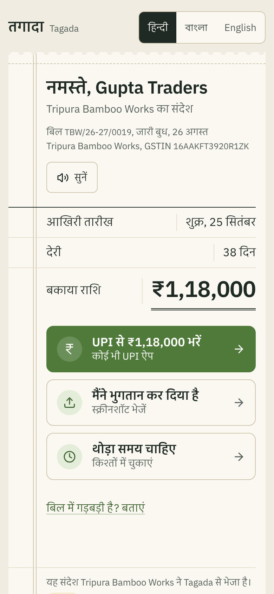</td>
<td>

The customer gets a mobile pay slip in **Hindi first**, with **Bengali** and **English** a tap away, and a **read-aloud** button that shows when it's loading and says plainly if the voice fails (and is hidden when the server has no voice). No login, and the link can't be guessed and expires. From it they can:

- **Pay by UPI**: one tap, the amount filled in, and a QR code on desktop.
- **मैंने भुगतान कर दिया है**, "I've already paid": upload a UPI screenshot. It is read for UTR, amount, date and payee, then checked against the bank credits. The answer is *found*, *not found yet* or *amount differs*, never "fake".
- **थोड़ा समय चाहिए**, "I need some time": pick a plan the owner's rule allows, or ask to talk.
- **बिल में गड़बड़ी है?**, "Something wrong with the bill?": raise a dispute, which stops the reminders until the owner resolves it.

Every action reaches the owner's **Inbox** within a second.

</td>
</tr>
</table>

### Bank: suggestions until the owner confirms

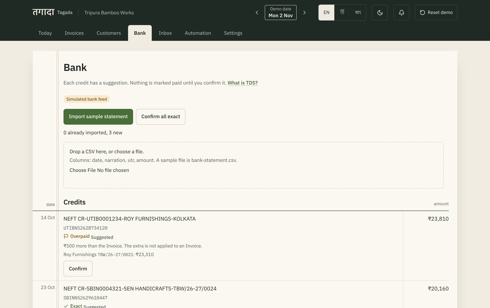

Import a statement, or drop your own CSV, and each credit gets a suggested match with a badge:

**Exact** · **Part** · **Multi-invoice** · **Overpaid** · **Unknown deposit** · **Possible TDS**

Invoice numbers are found in narrations however the bank wrote them. Customer names are compared loosely (M/s, Pvt Ltd, case and punctuation don't matter). One credit across several invoices pays the oldest first unless the narration names one. A shortfall of exactly 0.1%, 1%, 2% or 10% of the taxable value is flagged as possible TDS, with the likely section explained. **Nothing is marked paid until the owner presses Confirm.** Importing the same statement twice adds nothing.

### The Ladder: reminders that never go twice

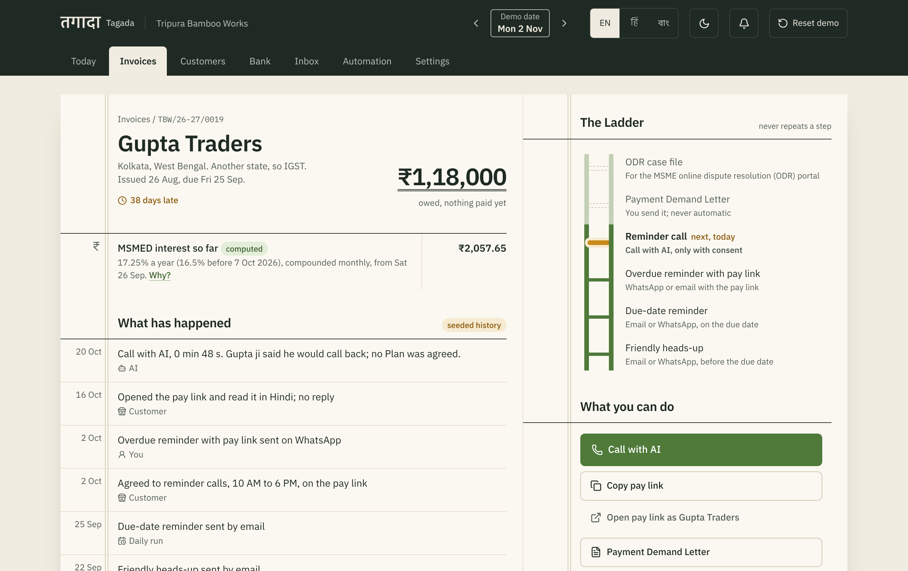

Every overdue invoice climbs six rungs, from a friendly heads-up to an ODR case file. The Ladder pauses on a promise, a plan or a dispute, starts again when a promise is broken, and never repeats a step. Each customer gets at most one message a day.

- **A real workflow**: every day at 10:00 IST, Render Cron starts a Render Workflows run that walks the Ladder and **sends real emails** to the demo inbox for the stages the owner has set to auto-send.
- **Never twice**: each reminder has its own key, so a retry or a second run can't send it again. One seeded customer's first email fails on purpose, so the retry shows in the **Automation log**.
- **Step the demo date** with ‹ › in the header. The same workflow runs for your world, so you can watch a promise break and the Ladder pick up again.
- **WhatsApp** reminders are one-tap links from five written templates, in the customer's language.

### Documents, done properly

- **New invoice** with live GST: CGST + SGST or IGST by place of supply, each rounded to the paisa, a round-off line and the amount in words. The GSTIN is checked live, check digit included. Each line takes an HSN, a unit and a quantity to three decimals; the due date starts at the Customer's credit days and can be changed. The form says what still stops Save. The server assigns the next financial-year number and recomputes every total, so the numbers can't be tampered with.
- **Correct, cancel or record a payment.** An unpaid invoice can be edited (lines and due date) or cancelled, never deleted: under GST its number stays used, and it drops out of what's owed, the Ladder and matching. A payment received outside the bank feed is recorded by hand, and Today counts it from its date.
- **The right document every time**: a Tax Invoice, a **Bill of Supply** with the exact composition heading, or a plain invoice, depending on the seller's registration. A "Preview as" switch shows every case.
- **Print-ready A4** invoices with a UPI QR code for the amount.
- **MSMED interest**: three times the RBI Bank Rate, compounded monthly, with the dated rate change (16.5% before 7 Oct 2026, 17.25% after) and a **Why?** showing the workings.
- **Section 43B(h)**: since FY 2023-24, a buyer may claim what they owe a micro or small enterprise as an expense in the Invoice's year only if they pay by the MSMED Act's appointed day (at most 45 days); paid later, only in the year they pay. It's a lawful reason for the buyer to pay on time, not a threat. The overdue reminders, the letter and the call say by when the bill stays in this year, always as "may", and the Invoice shows it with a **Why?**. A trader or a medium enterprise is never shown it.
- **Payment Demand Letter**: firm, correct, and never called a "legal notice". It is never sent automatically. A letterhead with GSTIN, the owner's Udyam number (set in **Settings**; the demo's sample one is badged as a sample, and no number means no Udyam line) and a reference number (`TBW/DL/26-27/0019`), the amount due in figures and words, UPI QR and bank transfer side by side, and the MSMED and 43B(h) notes as quiet notes above the signature.
- **ODR case file**: a cover box with the claimant, the respondent and the total claimed, then numbered sections: the invoices, the MSMED §16 interest table, the dated reminder history, a call excerpt with its English gloss, and the steps for the government's [odr.msme.gov.in](https://odr.msme.gov.in) portal.
- Both print as A4 in the customer's language (English, हिन्दी or বাংলা), with the business name and page numbers in the footer, and run onto a second page cleanly when the history is long.

<table>
<tr>
<td>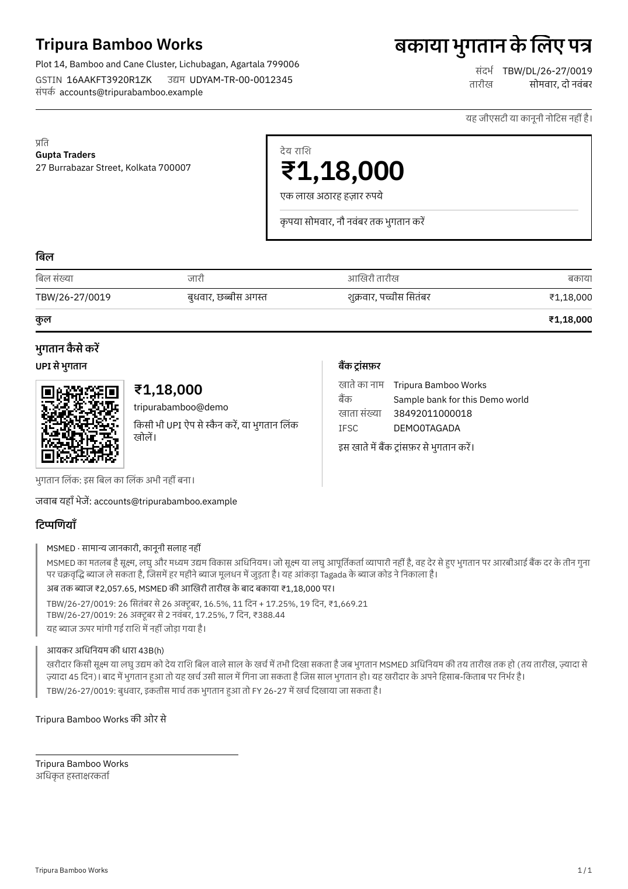</td>
<td>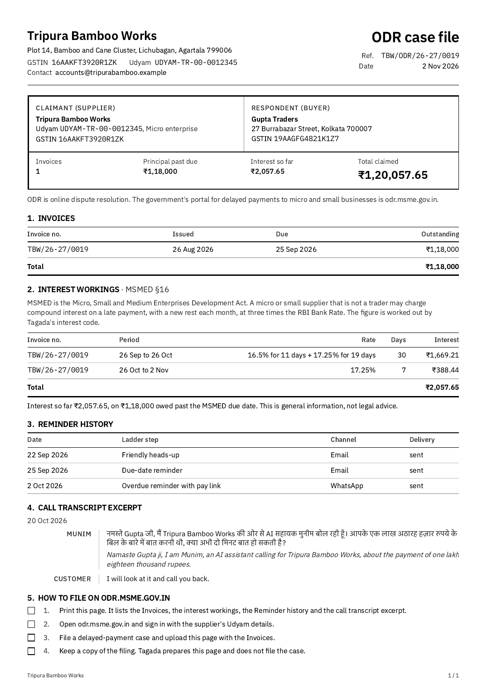</td>
</tr>
</table>

### Settings: the owner's rules

- **The business**: name, address, Udyam number, GST registration (regular, composition or none, which decides the document) and turnover (above ₹5 crore adds the e-invoicing note).
- **The Plan rule** that Call with AI and the pay link must keep.
- **Auto-send stages**: which Ladder messages the 10:00 run may email on its own; the rest wait in Today's follow-ups. The Payment Demand Letter is never one of them.
- **Your email, your language**, and **Your data** with *Delete my workspace* (see [Your data](#your-data)).

### Built for the owner's language and phone

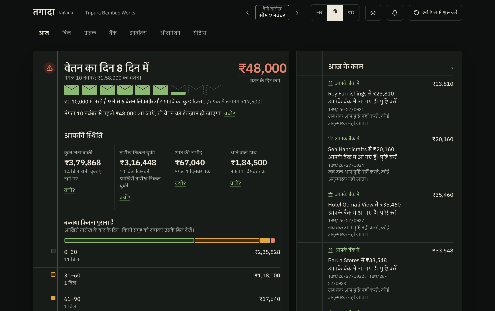

- **Every owner screen in English, हिन्दी and বাংলা**, switched in the header without a reload, with the same word for each idea everywhere. Dates and amounts follow the language.
- **Works at 360 px** with no sideways scrolling, and touch targets of at least 44 px.
- **Dark mode** follows the system or a toggle. Reduced motion is respected, and status is never shown by colour alone.

### /proof: every rupee, checked

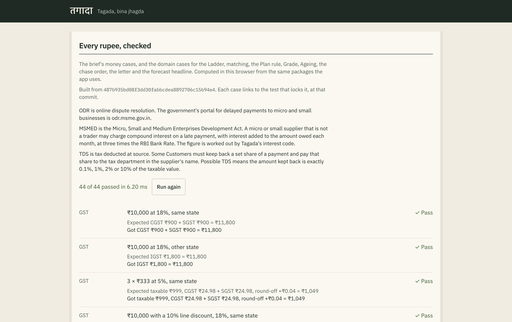

The brief's cases (GST, interest, GSTIN, numbering, Hindi words, matching, the Ladder, the Plan rule, grades, ageing, the chase order, the letter and the forecast headline), and Section 43B(h), run **in your browser, from the same packages the app uses**. Each shows its input, the expected value and the computed value, and links to the test that locks it at the deployed commit.

## How it's built

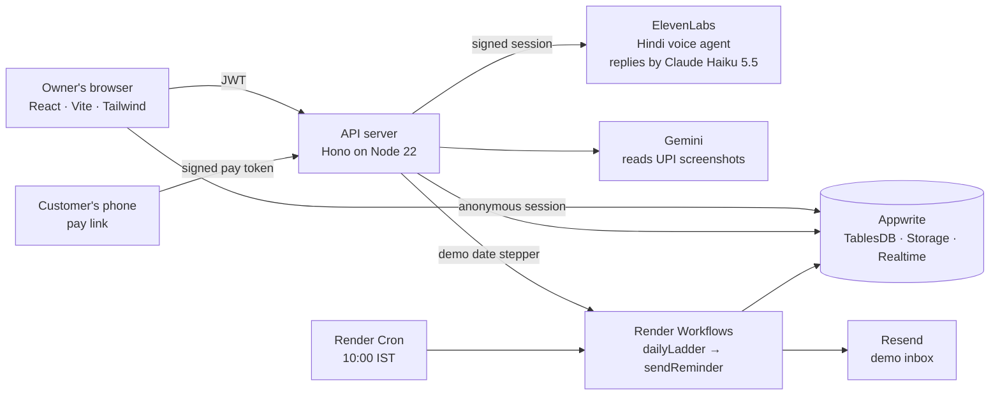

| Layer | What we used |
|---|---|
| Web | React 19, Vite, Tailwind CSS 4, React Router, Lucide; IBM Plex Sans, Devanagari and Mono; link previews (Open Graph) for sharing |
| Server | Hono on Node 22 (Render web service), the only place secrets live |
| Data | Appwrite: anonymous auth, TablesDB with row-level permissions, Storage, Realtime |
| Automation | Render Workflows (`dailyLadder` fans out one `sendReminder` per reminder, each retried by Render) and Render Cron |
| Voice | ElevenLabs conversational agent running Claude Haiku 5.5, private, with server-signed sessions and client tools; its config is in the repo and `pnpm agent:sync` applies it |
| Vision | Gemini reads payment screenshots; our code parses the amount |
| Email | Resend |
| Monorepo | pnpm workspaces, TypeScript throughout |

### The rules the code keeps

1. **Money is integer paise**, and only `packages/money` does arithmetic on it.
2. **The AI never decides money.** It doesn't compute amounts, approve plans or mark anything paid. The Plan rule is code, and the model only reads a screenshot's text.
3. **Customers never talk to the database.** The pay link talks to the server with a signed, expiring token that is verified without a database lookup.
4. **Secrets stay on the server.** The browser holds only the Appwrite endpoint and project ID.
5. **One demo date per workspace.** Every screen, the Ladder and the forecast read it, never the system clock.
6. **Every row belongs to its visitor**, with permissions set on each write, so two judges never see each other's books.

### Real and simulated

| Real | Simulated |
|---|---|
| GST and interest maths, the AI call, the daily Ladder workflow, reminder emails, bank matching, screenshot reading | The bank feed, the UPI ID, WhatsApp sending (one-tap links only), and the history before the demo date |

## Your data

Tagada is built to the [Digital Personal Data Protection Act, 2023](https://www.meity.gov.in/data-protection-framework): it keeps what the job needs, says where, and lets you delete it.

**What is stored.** No login: the app opens an anonymous Appwrite session, so it never asks for your name or email. Your workspace holds your business details and settings, your Customers (name, phone, email, GSTIN, and whether and when they agreed to reminder calls), Invoices, payments, Promises and Plans, the bank lines you import, the Reminders sent, Inbox messages from the pay link, the AI calls (duration, outcome, transcript and whether the consent check was shown), and the UPI screenshots Customers upload with what was read from them. Every row carries your user's permissions, so no other visitor can read it.

**Where.** Appwrite Cloud, and the server, workflow and cron on Render. Secrets stay on the server.

**Call consent.** Munim calls only a Customer whose consent is recorded with its date, only within calling hours (10 AM–6 PM on the demo clock), and says it is an AI in its first line. The call row keeps that the check was shown.

**Screenshots read by Gemini.** A UPI screenshot is sent to Google's Gemini API once, to read its UTR, amount, date and payee as text; our code parses the amount. The image stays in a Storage bucket only you can read, and the fields read are kept with the Invoice.

**Other services.** ElevenLabs runs the voice of the call, and the words of the call pass through the model it runs for Munim, Claude Haiku 5.5; Resend delivers reminder emails, in this demo only to the one Demo inbox. Read-aloud clips on the pay link are stored by the words spoken, not by workspace, so a repeat listen costs nothing.

**How long a demo workspace lives.** Until you delete it: nothing expires it on its own yet (an automatic clean-up after 30 days is the next step, not built for the hackathon). Pay links are signed to expire after 60 days.

**How to delete it.** **Settings → Your data → Delete my workspace** (हिन्दी: **मेरा वर्कस्पेस मिटाएँ**, বাংলা: **আমার ওয়ার্কস্পেস মুছুন**), then confirm. The server deletes every UPI screenshot your Customers sent, then every row of your workspace in every table, and opens a fresh copy of the demo books. It acts only on the workspace your own session names; the browser's word is never taken for it. **Reset demo** in the header puts the starting story back too, but leaves stored screenshots in place.

## Tested

| | |
|---|---|
| **610 unit tests** (Vitest) | Every money and domain rule, the server's routes (Delete my workspace among them: every table and file, and only the visitor's own), the call agent's checked-in config, the documents' tables and reference numbers, the language tables (missing keys, leftover English, wrong synonyms), and the Ladder's no-double-send guarantee. Run on every push by CI, with type checks. |
| **45 live cases** on `/proof` | The brief's cases and Section 43B(h), from the same packages, in the judge's own browser |
| **16 end-to-end tests** (Playwright), run against the live site | A customer's "already paid" reaching the owner's Inbox; adding, editing and billing a Customer and recording a payment; the tour to *Salary covered ✓* and `/proof`, twice in a row from a reset, and with `/proof` typed mid-tour; the call screen with calls off; a past call's transcript; read-aloud loading, failing and hidden; the language switch; each landing door, all in the first screen at 1280 and 390 px; the salary figure inside its card; the letter and the case file printed as A4 PDFs in English, Hindi and Bengali |

## The business case

**Who pays, and how.** The owner, either way they prefer:

- **A flat ₹499 a month** for up to 50 active Customers; or
- **1% of money recovered on Invoices already 60 or more days overdue**, charged only when the Bank screen confirms it arrived. Owners who doubt it pay nothing until it works.

**What it costs us.** A minute of Call with AI is 450 ElevenLabs credits, about **₹8.71**, so a two-minute call is about ₹17.40. A reminder email is about 3.5 paise on Resend. WhatsApp reminders are one-tap links from the owner's own phone, so they cost nothing. Chasing one Customer through a month (four emails and one call) costs about **₹18**, and Today's *What Tagada changed* shows the real cost per ₹100 collected.

**The market.** India's micro and small enterprises are owed **₹8.1 lakh crore** in late payments ([Economic Survey 2025-26](https://www.indiabudget.gov.in/economicsurvey/), Box VIII.11). The Udyam registry counts them in crores; Tagada's first users are the manufacturers and traders among them who sell on credit to bigger buyers.

**The competition.** Khatabook, Vyapar, OkCredit and Tally **record** what's owed. Tagada **collects** it: it ranks who to chase, calls politely in Hindi, takes the payment on a pay link, matches the bank statement, and turns MSMED Act interest and Section 43B(h) into reasons to pay on time. It sits beside the books an owner already keeps.

**How it reaches owners.** Through **CA firms**, who already see their clients' receivables at GST filing time, and through **industry associations** and MSME clusters, where one owner's "salary covered" travels by word of mouth. The pay link itself is a quiet advert: every Customer who opens one sees what a collections desk looks like.

## Questions judges ask

**Why one-tap WhatsApp links, not the WhatsApp Business API?**
The Business API needs a verified business, pre-approved templates and a per-message fee, and it sends from a number the Customer doesn't know. A one-tap link opens WhatsApp on the owner's phone with the message written, in the Customer's language, from the number the Customer already trusts. The owner presses send. The Business API is a later step for owners who want reminders fully automatic.

**What if the AI mishears an amount?**
It can't move money. The AI never decides an amount: the Plan rule is code. Every offer the agent hears goes to the server, which checks it against the owner's rule in integer paise and answers *agreed* or *needs your decision*; a plan outside the rule, or one missing a date, is refused with a sentence telling the agent what to say instead. The owner approves, counters or declines, and nothing is marked paid until the Bank screen's Confirm.

**Is it legal to call a customer?**
Munim calls only a Customer whose consent to reminder calls is recorded with its date, only within calling hours, and says it is an AI in its first line. It never threatens, and never mentions courts, police or credit scores. The Payment Demand Letter is never called a legal notice and is never sent automatically.

**What does it cost to run per customer?**
About ₹18 a month for a Customer chased with four emails and one two-minute call (see *What it costs us* above). Today shows the cost per ₹100 collected, from the real call durations.

**What's real and what's simulated?**
See [Real and simulated](#real-and-simulated): the maths, the AI call, the daily workflow, the emails, bank matching and screenshot reading are real; the bank feed, the UPI ID, WhatsApp sending and the history before the demo date are simulated.

**How does an owner bring their existing books?**
Today: add Customers and Invoices by hand (GSTIN checked live), and import bank statements as CSV on the Bank screen. A Tally or Excel invoice import is the next step, not built for the hackathon.

## Run it yourself

You need Node 22.12+, pnpm 11, an Appwrite project, and keys for ElevenLabs, Gemini and Resend. Every variable is listed in [`.env.example`](.env.example).

```bash
pnpm install
cp .env.example .env          # fill in the keys
pnpm appwrite:setup           # creates the tables, indexes and buckets, and adds new enum values (safe to re-run)
pnpm agent:sync               # creates or updates the ElevenLabs call agent from apps/server/src/agent/, prints its ID

pnpm dev:server               # API on http://localhost:8787
pnpm dev:web                  # app on http://localhost:5173

pnpm typecheck && pnpm test   # type checks and the unit tests
pnpm smoke                    # end-to-end tests; SMOKE_URL=<url> to point at a deploy
```

Everything deploys from [`render.yaml`](render.yaml): a static site, the web service, the workflow service and the cron job, sharing one environment group.

```
apps/
  web/         the owner's app, the pay link, the call, /proof
  server/      the API: demo worlds, calls, pay links, bank, Ladder runs
               (src/agent/: Munim's prompt and ElevenLabs config)
  workflows/   Render Workflows tasks: dailyLadder, sendReminder
packages/
  money/       paise, GST, interest, GSTIN, numbering, Hindi words, dates
  domain/      Ladder, Plan rule, matcher, forecast, grades, chase order, templates
  appwrite/    table IDs, schemas and typed row helpers
  seed/        the Tripura Bamboo Works world every visitor gets
tests/e2e/     Playwright smoke tests
```

---

<div align="center">

Built for **HackCache '26** · Problem statement 4: Invoice Chase

*Tagada, bina jhagda.*

</div>
