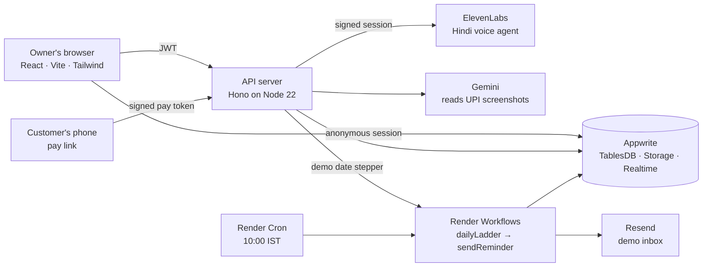

<div align="center">

# तगादा · Tagada

**Tagada, bina jhagda.** Chase what you're owed, without the quarrel.

A collections desk for India's small manufacturers: it ranks who to chase, calls them politely in Hindi, takes their payment on a pay link, matches the bank statement, and tells the owner whether salary day is safe.

**[Open the live app](https://app-web-dlk4.onrender.com)** · **[See every rupee checked](https://app-web-dlk4.onrender.com/proof)** · No login, no setup

[](https://github.com/Anikesh-Paul/hackcache-public/actions/workflows/ci.yml)


</div>

---

## The problem

India's micro and small businesses are waiting on **₹8.1 lakh crore** of late payments ([Economic Survey 2025-26](https://www.indiabudget.gov.in/economicsurvey/), Box VIII.11).

Meet Tripura Bamboo Works in Agartala: eight artisans and one accountant. On paper they're profitable. In practice, their customers in Kolkata and Guwahati pay weeks late, and every month the owner faces the same question: *can I pay salaries on the 10th?*

Today that owner chases each bill by hand. They remember who is overdue, phone in Hindi, write reminders, and check the bank statement line by line against "I've already paid." Nothing tells them what a customer's promise does to next week's cash.

Tagada opens on the one number that matters:

> **Salary day in 8 days · ₹48,000 short**

Every screen exists to turn that number green.

## Try it in 60 seconds

Open **[app-web-dlk4.onrender.com](https://app-web-dlk4.onrender.com)**. While you read the landing page, Tagada quietly builds **your own private copy of the books**: 12 customers and 31 invoices over six months. Nothing you do changes anyone else's screens. Then pick a door:

| Door | What happens |
|---|---|
| **Start the 2-minute tour** | Eight steps. The app moves itself to each screen and changes the books for you, from ₹48,000 short to salaries covered. |
| **Make your own invoice** | Bill any customer, or add one with your own name (GSTIN optional, part quantities like 2.5 kg are fine). Open its pay link as that customer, say it's paid, ask for time or dispute it, and watch Today and the bell change. Add or edit a Customer with your own email, record a payment by hand, or correct or cancel an unpaid invoice. |
| **Be Gupta ji: take the call** | You play the customer. Speak Hindi or English to Munim, the AI agent, and watch the owner's books change as you talk. No microphone? Read or play the recorded call instead. |
| **See the proof** | 44 test cases from the brief (GST, interest, matching, the Ladder, grades), computed live in your browser from the same code the app runs. |

**Reset demo** in the header brings the starting story back at any time.

## What it does

### Today: is salary day safe?


- **The headline**: salary day, the shortfall or the spare, and nine pay packets, one for each person paid that day, filling as cash is secured.
- **Why?** next to every number: opening cash plus expected receipts, minus salaries, rent and suppliers, to the day.
- **Your position**: total receivables, overdue, expected collections (delay-adjusted) and upcoming expenses.
- **Ageing** in 0–30 / 31–60 / 61–90 / 90+ day buckets; tap one to open those invoices.
- **A 13-week cash forecast** drawn as ledger bars, with shortfall weeks hanging below the line and a table view for exact numbers.
- **Chase these first**: unpaid invoices ranked by how much of the gap each would close, how reliably that customer pays, and how much effort the chase takes, each with its reason in words.
- **Today's follow-ups**: what the Ladder wants sent today, with the message ready to go by WhatsApp or email.

### Call with AI: a polite Hindi call, with code holding the line


Munim is a Hindi voice agent that calls the customer from the browser. The guardrails are checked before every call, and you can see them:

- the customer's recorded consent, and calling hours (10 AM–6 PM on the demo clock);
- Munim says it is an AI in its first line;
- no threats, and no talk of courts, police or credit scores;
- **the owner's Plan rule** (by default: at least 50% within 7 days, the rest within 30).

**Code checks the Plan rule, not the AI.** When Gupta ji offers ₹40,000, the rule check appears in the margin and Munim counters with exactly the minimum, ₹59,000. When he says ₹60,000, the new figure is checked again. A plan outside the rule, or one missing a date, is refused by the server with a sentence telling the agent what to do instead. The owner sees *Plan agreed* or *Needs your decision* and can approve, counter or decline. Approving pauses the Ladder for that customer, puts the plan on the pay link, and turns the headline to **Salary covered, ₹12,000 spare**.

There are three personas to play (*Cooperative*, *Short on cash*, *Disputes the bill*), each with lines to say in Hindi and English. The cost of every call is computed from its real duration. Each workspace gets 5 calls and the whole app 60 a day, so the public link can't drain the voice credits.

### The pay link: what the customer sees

<table>
<tr>
<td width="300"></td>
<td>

The customer gets a mobile pay slip in **Hindi first**, with **Bengali** and **English** a tap away, and a **read-aloud** button. No login, and the link can't be guessed and expires. From it they can:

- **Pay by UPI**: one tap, the amount filled in, and a QR code on desktop.
- **मैंने भुगतान कर दिया है**, "I've already paid": upload a UPI screenshot. It is read for UTR, amount, date and payee, then checked against the bank credits. The answer is *found*, *not found yet* or *amount differs*, never "fake".
- **थोड़ा समय चाहिए**, "I need some time": pick a plan the owner's rule allows, or ask to talk.
- **बिल में गड़बड़ी है?**, "Something wrong with the bill?": raise a dispute, which stops the reminders until the owner resolves it.

Every action reaches the owner's **Inbox** within a second.

</td>
</tr>
</table>

### Bank: suggestions until the owner confirms


Import a statement, or drop your own CSV, and each credit gets a suggested match with a badge:

**Exact** · **Part** · **Multi-invoice** · **Overpaid** · **Unknown deposit** · **Possible TDS**

Invoice numbers are found in narrations however the bank wrote them. Customer names are compared loosely (M/s, Pvt Ltd, case and punctuation don't matter). One credit across several invoices pays the oldest first unless the narration names one. A shortfall of exactly 0.1%, 1%, 2% or 10% of the taxable value is flagged as possible TDS, with the likely section explained. **Nothing is marked paid until the owner presses Confirm.** Importing the same statement twice adds nothing.

### The Ladder: reminders that never go twice


Every overdue invoice climbs six rungs, from a friendly heads-up to an ODR case file. The Ladder pauses on a promise, a plan or a dispute, starts again when a promise is broken, and never repeats a step. Each customer gets at most one message a day.

- **A real workflow**: every day at 10:00 IST, Render Cron starts a Render Workflows run that walks the Ladder and **sends real emails** to the demo inbox for the stages the owner has set to auto-send.
- **Never twice**: each reminder has its own key, so a retry or a second run can't send it again. One seeded customer's first email fails on purpose, so the retry shows in the **Automation log**.
- **Step the demo date** with ‹ › in the header. The same workflow runs for your world, so you can watch a promise break and the Ladder pick up again.
- **WhatsApp** reminders are one-tap links from five written templates, in the customer's language.

### Documents, done properly

- **New invoice** with live GST: CGST + SGST or IGST by place of supply, each rounded to the paisa, a round-off line and the amount in words. The GSTIN is checked live, check digit included. The server assigns the next financial-year number and recomputes every total, so the numbers can't be tampered with.
- **The right document every time**: a Tax Invoice, a **Bill of Supply** with the exact composition heading, or a plain invoice, depending on the seller's registration. A "Preview as" switch shows every case.
- **Print-ready A4** invoices with a UPI QR code for the amount.
- **MSMED interest**: three times the RBI Bank Rate, compounded monthly, with the dated rate change (16.5% before 7 Oct 2026, 17.25% after) and a **Why?** showing the workings.
- **Payment Demand Letter**: firm, correct, and never called a "legal notice". It is never sent automatically.
- **ODR case file**: one page with invoices, interest workings, the reminder history, a call excerpt and numbered steps for the government's [odr.msme.gov.in](https://odr.msme.gov.in) portal.

### Built for the owner's language and phone


- **Every owner screen in English, हिन्दी and বাংলা**, switched in the header without a reload, with the same word for each idea everywhere. Dates and amounts follow the language.
- **Works at 360 px** with no sideways scrolling, and touch targets of at least 44 px.
- **Dark mode** follows the system or a toggle. Reduced motion is respected, and status is never shown by colour alone.

### /proof: every rupee, checked


The brief's cases (GST, interest, GSTIN, numbering, Hindi words, matching, the Ladder, the Plan rule, grades, ageing, the chase order, the letter and the forecast headline) run **in your browser, from the same packages the app uses**. Each shows its input, the expected value and the computed value, and links to the test that locks it at the deployed commit.

## How it's built



| Layer | What we used |
|---|---|
| Web | React 19, Vite, Tailwind CSS 4, React Router, Lucide; IBM Plex Sans, Devanagari and Mono |
| Server | Hono on Node 22 (Render web service), the only place secrets live |
| Data | Appwrite (Singapore): anonymous auth, TablesDB with row-level permissions, Storage, Realtime |
| Automation | Render Workflows (`dailyLadder` fans out one `sendReminder` per reminder, each retried by Render) and Render Cron |
| Voice | ElevenLabs conversational agent, private, with server-signed sessions and client tools |
| Vision | Gemini reads payment screenshots; our code parses the amount |
| Email | Resend |
| Monorepo | pnpm workspaces, TypeScript throughout |

### The rules the code keeps

1. **Money is integer paise**, and only `packages/money` does arithmetic on it.
2. **The AI never decides money.** It doesn't compute amounts, approve plans or mark anything paid. The Plan rule is code, and the model only reads a screenshot's text.
3. **Customers never talk to the database.** The pay link talks to the server with a signed, expiring token that is verified without a database lookup.
4. **Secrets stay on the server.** The browser holds only the Appwrite endpoint and project ID.
5. **One demo date per workspace.** Every screen, the Ladder and the forecast read it, never the system clock.
6. **Every row belongs to its visitor**, with permissions set on each write, so two judges never see each other's books.

### Real and simulated

| Real | Simulated |
|---|---|
| GST and interest maths, the AI call, the daily Ladder workflow, reminder emails, bank matching, screenshot reading | The bank feed, the UPI ID, WhatsApp sending (one-tap links only), and the history before the demo date |

## Tested

| | |
|---|---|
| **508 unit tests** (Vitest) | Every money and domain rule, the server's routes, the language tables (missing keys, leftover English, wrong synonyms), and the Ladder's no-double-send guarantee. Run on every push by CI, with type checks. |
| **44 live cases** on `/proof` | The brief's cases, from the same packages, in the judge's own browser |
| **5 end-to-end tests** (Playwright), run against the live site | A customer's "already paid" reaching the owner's Inbox; the tour to *Salary covered ✓* and `/proof`; the tour twice in a row from a reset with no failed send; `/proof` typed mid-tour; the language switch |

## Run it yourself

You need Node 22.12+, pnpm 11, an Appwrite project, and keys for ElevenLabs, Gemini and Resend. Every variable is listed in [`.env.example`](.env.example).

```bash
pnpm install
cp .env.example .env          # fill in the keys
pnpm appwrite:setup           # creates the tables, indexes and buckets, and adds new enum values (safe to re-run)

pnpm dev:server               # API on http://localhost:8787
pnpm dev:web                  # app on http://localhost:5173

pnpm typecheck && pnpm test   # type checks and the unit tests
pnpm smoke                    # end-to-end tests; SMOKE_URL=<url> to point at a deploy
```

Everything deploys from [`render.yaml`](render.yaml): a static site, the web service, the workflow service and the cron job, sharing one environment group.

```
apps/
  web/         the owner's app, the pay link, the call, /proof
  server/      the API: demo worlds, calls, pay links, bank, Ladder runs
  workflows/   Render Workflows tasks: dailyLadder, sendReminder
packages/
  money/       paise, GST, interest, GSTIN, numbering, Hindi words, dates
  domain/      Ladder, Plan rule, matcher, forecast, grades, chase order, templates
  appwrite/    table IDs, schemas and typed row helpers
  seed/        the Tripura Bamboo Works world every visitor gets
tests/e2e/     Playwright smoke tests
```

---

<div align="center">

Built for **HackCache '26** · Problem statement 4: Invoice Chase

*Tagada, bina jhagda.*

</div>
